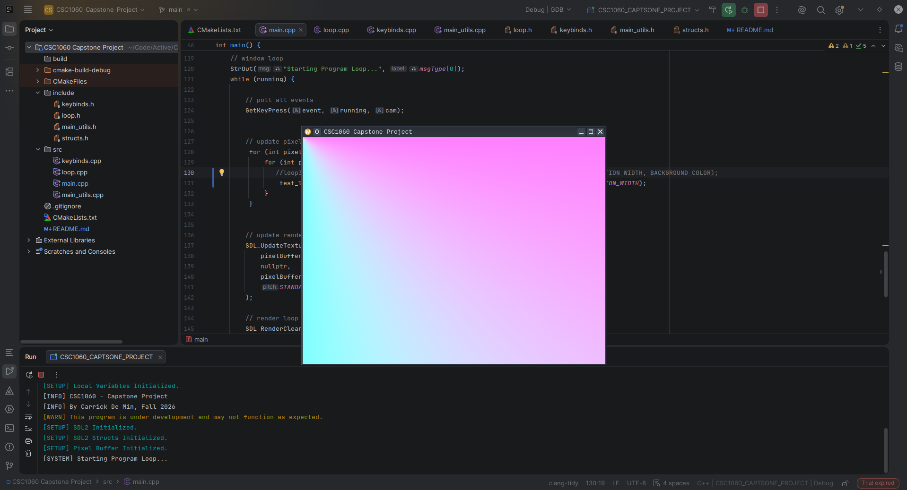
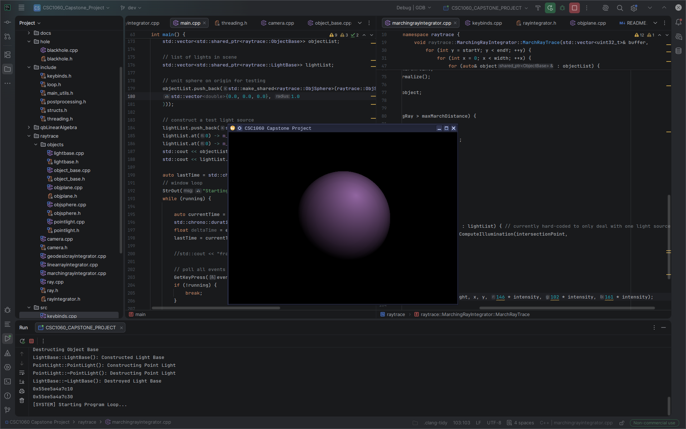

# CSC1060 Capstone - Black Hole Sim

A (not quite) real-time visual simulation of a Black Hole, including Doppler Effect, Gravitational Lensing, Accretion Disk, and Halo.

CPU traced representation of light rays passing through a black hole in space.
 - C++ Calculates light rays, star position and black hole effects
 - Each pixel gets an RBG value in a pixel buffer
 - SDL2 renders pixel buffer to screen using GPU (requires graphics card or modern CPU with an igpu)

## Run/Install (Linux or Windows)

This project has cross-platform makefiles included via CMake.

To install and run, simply download or clone this repository, navigate to ./build and run the linux application file or build from source.

**Linux**
- ./CSC1060_Captstone_Project/build
- Find ./CSC1060_CAPSTONE_PROJECT
- Execute via file manager or terminal

---

**Windows**
- TK 

You can use the following commands to simplify the installation (only tested on Linux) to install the latest git push from main:

(Ensure that you have git and base-devel installed, as well as cmake and a cpp compiler)

~~~bash
git clone https://github.com/cloverless08/black-hole-simulation.git
cd black-hole-simulation
rm -rf ./build/
cmake -S . -B build
cd ./build && make && cd ..
cp ./build/CSC1060_CAPSTONE_PROJECT ./BlackHoleSimExec
~~~

***OR***

Download the platform-specific executable here (without source code):
 - [Windows](link TK)
 - [Linux](link TK)

## Controls/Keybinds
- Arrow Keys: Control camera pitch and yaw
- d: Display diagnostic info to terminal/screend
- s: Save snapshot of current frame
- p: Pause simulation
- q: Output Camera Position
- Esc: Quit App

## Authors

Carrick De Min:
- Github [@cloverless08](https://www.github.com/cloverless08)
- Instagram [@carrick.ature](https://www.instagram.com/carrick.ature)

## AI Use Disclaimer
As is standard convention in my projects, and to uphold my education
and academic honesty, *no generative AI tools (such as ChatGPT or Claude Code)
were used to write, generate, or create any code or other submitted project content.*

***Any use of Artificial Intelligence for any other reason will be comprehensively listed below:***

- AI tools played a minor role in compiling research resources
and articles for me to read, and sometimes was used to explain parts of these documents like equations and procedures.

- AI was occasionally used as personal tutor to explain certain
  C++ and programming concepts as I was learning them. 
  However, any resulting knowledge was independently applied and implemented by me once it was understood.

- AI use in this project aligns with the 
*FRCC Code of Conduct* and the requirements outlined in the CSC1060 syllabus.

- GitHub occasionally generated commit messages for changes that were staged in the remote repository or when made within a GitHub CodeSpace

Please refer to the tags in the **Sources** section of this readme for more specifics.

## License

This project uses the GNU General Public License version 3
to allow unrestricted access, especially within an academic environment.

~~~ Synopsis
This program is free software: you can redistribute it and/or modify
it under the terms of the GNU General Public License as published by
the Free Software Foundation, either version 3 of the License, or
(at your option) any later version.

This program is distributed in the hope that it will be useful,
but WITHOUT ANY WARRANTY; without even the implied warranty of
MERCHANTABILITY or FITNESS FOR A PARTICULAR PURPOSE.  See the
GNU General Public License for more details.
~~~

The full text of the license can be found here for reference:

[GPL v3.0](https://choosealicense.com/licenses/gpl-3.0/)

## Screenshots

---

⠀⠀⠀⠀⠀⠀⠀⠀⠀⠀⠀⠀⠀⠀⠀⠀⠀⠀⠀⠀⠀⠀⠀⠀⠀⠀⠀⠀⠀⠀⠀⠀⠀⠀⠀⠀⠀⠀⠀⠀⠀⠀⡀⠀⠀⠀⠀⠀⠀⠀⠀⠀⠀⠀⠀⠀⠀⠀⠀⠀⠀⠀⠀⠀⠀⠀⠀⠀⠀
⠀⠀⠀⠀⠀⠀⠀⠀⠀⠀⠀⠀⠀⠀⠀⠀⠀⠀⠀⠀⠀⠀⠀⠀⠀⠀⠀⠀⠀⠀⠀⠀⠀⠀⠈⠀⠀⠀⠀⠀⠀⠀⠀⠀⠀⠀⠀⠀⠀⠀⠀⠀⠀⠀⠀⠀⠀⠀⠀⠀⠀⠀⠀⠀⠀⠀⠀⠀⠀
⠀⠀⠀⠀⠀⠀⠀⠀⠀⠀⠀⠀⠀⠀⠀⠀⠀⠀⠀⠀⠀⠀⠀⠀⠀⠖⠃⠀⠀⠀⡁⠀⠀⠀⠀⠀⠐⠆⠀⠀⠀⠀⠀⠀⠁⠀⠀⠀⠀⠀⠀⠀⠀⠀⠀⠀⠀⠀⠀⡠⢔⡤⠊⠁⠀⠀⠀⠀⠀
⠀⠀⠀⠀⠀⠀⠀⠀⠀⠀⠀⠀⠀⠀⠀⠀⠀⠀⠁⠀⠀⠀⠁⠀⠀⠘⠁⢀⠀⠀⠀⠀⢈⠓⠂⠠⡄⠀⠈⠀⠀⠀⠀⠀⠀⠀⠀⠀⠀⠀⠀⠀⠀⢀⣠⣶⠿⠞⠋⠁⠀⠀⠀⠀⠀⠀⠀⠀⠀
⠀⠀⠀⠀⠀⠀⠀⠀⠀⠀⠀⠀⠀⠀⠀⠀⠀⠀⠀⠀⠀⠒⠁⠀⠠⡚⠁⢀⣙⣀⣈⡩⠬⢁⠀⢑⠶⠤⡆⠤⡀⠀⠀⠀⠀⠀⠀⢀⠴⢲⣋⣽⣷⠟⠃⠀⠀⠀⠀⠀⠀⠀⠀⠀⠀⠀⠀⠀⠀
⠀⠀⠀⠀⠀⠀⠀⠀⠀⠀⠀⠀⠀⠀⠀⠀⠁⠀⢠⠀⠀⣶⠃⠗⣡⣶⣮⣿⡿⠿⠿⢿⣿⣷⣶⣤⣤⠤⠴⠦⠬⣤⣤⠄⣉⠉⠝⢲⣿⡷⠻⠂⠀⠀⠀⠀⠀⠀⠀⠀⠀⠀⠀⠀⠀⠀⠀⠀⠀
⠀⠀⠀⠀⠀⠀⠀⠀⠀⠀⠀⠀⠀⠈⠀⠀⠀⠀⠁⡀⡸⠁⣰⣿⡿⠛⠋⣁⡀⠤⠤⢄⡀⠈⠛⢯⣿⣟⣾⣶⣶⣮⣭⣵⣾⣿⣟⠿⠉⢨⠖⠃⠀⠀⠀⠀⠀⠀⠀⠀⠀⠀⠀⠀⠀⠀⠀⠀⠀
⠀⠀⠀⠀⠀⠀⠀⠀⠀⠀⠀⠀⠀⠀⠀⠀⢠⠀⢠⠳⡧⣻⡿⠋⢀⠒⠉⠀⠀⠀⠀⠀⠀⠉⠢⠀⠀⠙⠛⣻⣿⣿⣿⢿⣿⣿⠟⡱⠖⠊⠁⠀⠀⠀⠀⠀⠀⠀⠀⠀⠀⠀⠀⠀⠀⠀⠀⠀⠀
⠀⠀⠀⠀⠀⠀⠀⠀⠀⠀⠀⠀⠀⠀⠀⠀⠁⢠⣧⠓⣾⣿⠁⠀⠃⠀⠀⠀⠀⠀⠀⠀⠀⠀⠀⠉⢦⣠⣾⣿⠿⣿⣿⣿⡿⣫⠏⠁⠀⠀⠀⠀⠀⠀⠀⠀⠀⠀⠀⠀⠀⠀⠀⠀⠀⠀⠀⠀⠀
⠀⠀⠀⠀⠀⠀⠀⠀⠀⠀⠀⠀⠀⠀⠀⡀⠀⠂⢃⣸⣿⠇⢠⠃⠀⠀⠀⠀⠀⠀⠀⠀⠀⢀⣠⣴⣿⠟⢿⠁⠸⡿⣿⣯⡶⠃⠀⠀⠀⠀⠀⠀⠀⠀⠀⠀⠀⠀⠀⠀⠀⠀⠀⠀⠀⠀⠀⠀⠀
⠀⠀⠀⠀⠀⠀⠀⠀⠀⠀⠀⠀⠀⠀⠀⠁⢘⡄⠘⣿⣿⠀⠸⡀⠀⠀⠀⠀⠀⢀⣀⣴⣾⣿⡿⡟⡋⠐⡇⠀⢸⣿⣿⠃⠀⠁⠀⠀⠀⠀⠀⠀⠀⠀⠀⠀⠀⠀⠀⠀⠀⠀⠀⠀⠀⠀⠀⠀⠀
⠀⠀⠀⠀⠀⠀⠀⠀⠀⠀⠀⠀⠀⠀⠀⠀⢡⠘⢰⣿⡿⡆⠀⣇⠀⣀⣠⣤⣶⣿⢷⢟⠻⠀⠈⠀⠀⠀⡇⠀⣼⣿⣿⠂⠀⡀⠀⠀⠀⠀⠀⠀⠀⠀⠀⠀⠀⠀⠀⠀⠀⠀⠀⠀⠀⠀⠀⠀⠀
⠀⠀⠀⠀⠀⠀⠀⠀⠀⠀⠀⠀⠀⢀⠔⢀⡴⢯⣾⠟⡏⢀⣠⣿⣿⣿⣟⢟⡋⠅⠘⠉⠀⠀⠀⠀⢀⠀⠁⢠⣿⣟⠃⠀⠁⠀⠀⠀⠀⠀⠀⠀⠀⠀⠀⠀⠀⠀⠀⠀⠀⠀⠀⠀⠀⠀⠀⠀⠀
⠀⠀⠀⠀⠀⠀⠀⠀⠀⠀⠀⠀⠀⢠⠞⣻⣷⡿⢙⣩⣶⡿⠿⠛⠉⠑⢡⡁⠀⠀⠀⠀⠀⠀⢀⠔⠁⠀⣰⣿⣿⡟⠀⠀⠀⠀⠀⠀⠀⠀⠀⠀⠀⠀⠀⠀⠀⠀⠀⠀⠀⠀⠀⠀⠀⠀⠀⠀⠀
⠀⠀⠀⠀⠀⠀⠀⠀⠀⠀⠀⣡⣾⣥⣾⢫⡦⠾⠛⠙⠉⠀⠀⢀⣀⠀⠈⠙⠓⠦⠤⠤⠀⠘⠁⢀⡤⣾⡿⠏⠁⠀⠀⠀⠀⠀⠀⠀⠀⠀⠀⠀⠀⠀⠀⠀⠀⠀⠀⠀⠀⠀⠀⠀⠀⠀⠀⠀⠀
⠀⠀⠀⠀⠀⠀⠀⠀⠔⣴⣾⣿⣿⢟⢝⠢⠃⢀⣤⢴⣾⣮⣷⣶⢿⣶⡤⣐⡀⠀⣠⣤⢶⣪⣿⣿⡿⠟⠀⠀⠀⠀⠀⠀⠀⠀⠀⠀⠀⠀⠀⠀⠀⠀⠀⠀⠀⠀⠀⠀⠀⠀⠀⠀⠀⠀⠀⠀⠀
⠀⠀⠀⠀⠀⠀⡀⣦⣾⡿⡛⠵⠺⢈⡠⠶⠿⠥⠥⡭⠉⠉⢱⡛⠻⠿⣿⣿⣿⣿⣿⠿⠿⠿⠟⠭⠛⠂⠀⠀⠀⠀⠀⠀⠀⠀⠀⠀⠀⠀⠀⠀⠀⠀⠀⠀⠀⠀⠀⠀⠀⠀⠀⠀⠀⠀⠀⠀⠀
⠀⠀⠀⢀⢴⠕⣋⠝⠕⠐⠀⠔⠉⠀⠀⠀⠀⠁⠀⠀⠀⠀⠀⠀⠀⠀⠀⠉⠁⠉⠁⠁⠁⠁⠈⠀⠁⠀⠀⠀⠀⠀⠀⠀⠀⠀⠀⠀⠀⠀⠀⠀⠀⠀⠀⠀⠀⠀⠀⠀⠀⠀⠀⠀⠀⠀⠀⠀⠀
⢀⣠⠁⠈⠀⠀⠀⠀⠀⠀⠀⠀⠀⠀⠀⠀⠀⠀⠀⠀⠀⠀⠀⠀⠀⠀⠀⠀⠀⠀⠀⠀⠀⠀⠀⠀⠀⠀⠀⠀⠀⠀⠀⠀⠀⠀⠀⠀⠀⠀⠀⠀⠀⠀⠀⠀⠀⠀⠀⠀⠀⠀⠀⠀⠀⠀⠀⠀⠀
⠀⠀⠀⠀⠀⠀⠀⠀⠀⠀⠀⠀⠀⠀⠀⠀⠀⠀⠀⠀⠀⠀⠀⠀⠀⠀⠀⠀⠀⠀⠀⠀⠀⠀⠀⠀⠀⠀⠀⠀⠀⠀⠀⠀⠀⠀⠀⠀⠀⠀⠀⠀⠀⠀⠀⠀⠀⠀⠀⠀⠀⠀⠀⠀⠀⠀⠀⠀⠀
⠀⠀⠀⠀⠀⠀⠀⠀⠀⠀⠀⠀⠀⠀⠀⠀⠀⠀⠀⠀⠀⠀⠀⠀⠀⠀⠀⠀⠀⠀⠀⠀⠀⠀⠀⠀⠀⠀⠀⠀⠀⠀⠀⠀⠀⠀⠀⠀⠀⠀⠀⠀⠀⠀⠀⠀⠀⠀⠀⠀⠀⠀⠀⠀⠀⠀⠀⠀⠀

## Sources

--- 

**Research and reference materials consulted during the development of this project:**

### General Relativity & Black Holes
- *Black Hole* — Wikipedia
- *Black Hole Horizons*
- *The Black Hole Equation* — Explained
- *Schwarzschild Metric* — Wikipedia
- *Anatomy* — NASA Science

### Geometrized Units
- *Geometrized Units* — The Spectrum
- *Main — Geometrized Units*
- *Geometrized Unit System* — Wikipedia

### Ray Tracing & Computer Graphics
- *Ray Tracing with C++*
- *Ray Tracing (Graphics)* — Wikipedia
- *An Introduction to Ray Tracing*

### Additional References
- *Gravity: How...* — C++ Forum

### Tools Used
- JetBrains CLion
- NeoVim
- cmake
- GitHub Codespaces

--- 

**Relevant or resource projects:**

### Ray Tracer Test - Carrick De Min
Concurrent research project specifically for learning how to implement this simulation's raytracer.
~~~
https://github.com/cloverless08/raytracer-test.git
~~~

---

**Libraries or Repositories:**

## SDL2
 - Used for displaying the pixel buffer to the screen, initializing a window, and reducing the need for GPU calculations.
~~~
https://github.com/libsdl-org/SDL.git
~~~

## "Linear Algebra in  C++ - Part 4 - A simple Vector class"
 - Tutorial helpful for matrix math implementations
